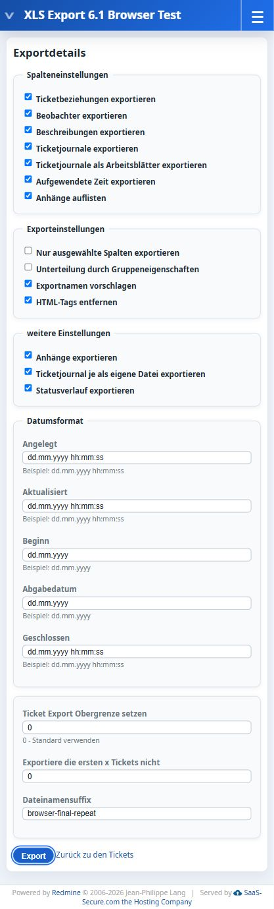

# Redmine 6.1 validation

Date: **2026-10-17**. Plugin release: **1.0.0**.

## Environment

| Component | Version |
| --- | --- |
| Redmine | 6.1.2-stable |
| Rails | 7.2.3 |
| Ruby | 3.3.7, Linux container |
| Database | MySQL 8.4.11 |
| Spreadsheet | 1.3.5 |
| Rubyzip | 2.4.1 |
| Browser | Codex integrated browser |

Other installed plugins include Redmine UX Toolkit, Redcase and several issue-related extensions. This checks the local integration environment; arbitrary third-party plugin combinations are outside the scope.

## Automated verification

```sh
bundle exec rake zeitwerk:check
bundle exec rails runner plugins/redmine_xls_export/test/compatibility_smoke.rb
bundle exec rails runner plugins/redmine_xls_export/test/reload_smoke.rb
```

- **52 compatibility checks**: Rails requests by a temporary non-admin user, followed by binary XLS/ZIP parsing and content assertions. Database changes are rolled back; temporary attachment files are removed.
- **Three reload cycles**: controller/export module availability, exactly one hook listener and XLS/ZIP support after each reload. Reinitialization is isolated to this plugin because other installed plugins have independent reload behavior.
- **Zeitwerk check**: successful eager loading.
- **Asset precompilation**: successful in the local development container.

| Area | Verified behavior |
| --- | --- |
| Export links | Real Quick/Detailed links, explicit query sorting in their URLs |
| Queries | Filters, saved-query columns/sorting, private-query denial, invalid-query validation |
| Worksheets | All/selected columns, issue hyperlinks, aligned formats, no duplicate columns |
| Values | Descriptions, numeric/date/multi-value custom fields, percentages and timestamps |
| Options | Journal column, worksheets enabled/disabled, spent time, watchers and visible relations |
| ZIP | Correct media type/signature, Unicode attachment names, duplicate attachment contents, separate journals and status history |
| Permissions | Private issues/parents/notes, custom field roles, unrelated projects and global export visibility |
| Status history | Visible transitions and deleted assignees |
| Boundaries | Offset/limit, negative/overflow offset, empty workbook, row rollover and actionable column-limit error |
| Localization | German journal/status/date labels |

Boundary checks temporarily lower the constants in the isolated runner process to exercise rollover/error handling without allocating over 65,000 records.

## Integrated browser verification

Test project: **XLS Export 6.1 Browser Test** (`xls-export-61-browser-test`). Two test issues contain descriptions, categories, journals, Unicode attachments, watchers and time entries. The project is retained locally for inspection.

| Workflow | Result |
| --- | --- |
| Global/project issue lists | Quick and Detailed links appear |
| Quick download | Valid XLS with both project issues |
| Detailed form | Every option and date field is available |
| Save administrator defaults | Checked/unchecked values persist; original defaults restored |
| Full detailed export | Workbook, journal sheets/files, attachments and status history download in ZIP |
| Grouped selected-column export | Unique, valid sheet names despite colliding long category names |
| German interface | No missing translations; German status-history headers |
| Repeat download | Second ZIP downloads from the same form; Export remains enabled |
| Browser console | No errors/warnings in checked export workflows |
| Responsive layout | Form usable in the narrow integrated browser pane |

Actual downloads were reopened with Spreadsheet and Rubyzip. The final German archive contains:

```text
261017_XLS_Export_6.1_Browser_Test_browser-final-repeat.xls
attachments/266/Grüße-Anhang.txt
attachments/267/Grüße-Anhang.txt
journals/266_journal_details.xls
journals/267_journal_details.xls
status_histories.xls
```

The main workbook contains `Tickets` and two journal worksheets. Both attachments match the test text, including umlauts. The status-history workbook contains a header and two transitions, with translated headings. The grouped download contained two issue worksheets and two journal worksheets.

The original account language was restored to English after the German checks. This screenshot records the successful German repeat-download test:



## Scope and limits

No known plugin failure remains in the checked workflows. This validates the recorded environment; it does not guarantee every Redmine 6.1 patch level, database adapter or plugin combination.

- XLS limits: 256 columns, 65,536 rows per sheet including the header, 31-character worksheet names and 32,767 characters per cell.
- Exports use memory; large attachment collections need suitable resource limits/batching.
- XLS/ZIP files were parsed programmatically. Excel/LibreOffice visual rendering was not checked.
- Production-load benchmarking, missing-file notices and sub-URI deployments were not tested in the browser.
- GitHub Actions is configured for a clean Redmine 6.1.2/MySQL 8.4 installation.
